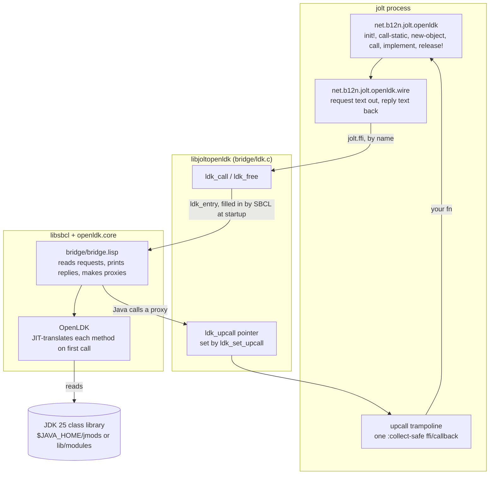
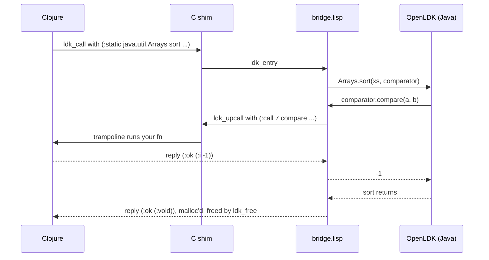

# jolt-openldk

[](https://github.com/jlt-commons/jolt-openldk/actions/workflows/ci.yml)

> [!WARNING]
> **Alpha.** This project is days old and still finding its shape. The API, the wire protocol between jolt and the bridge, the build layout and the supported platforms may all change without notice or a deprecation path. Don't build anything you can't easily rework on top of it yet.

Java libraries from [jolt](https://github.com/jolt-lang/jolt), with no JVM in the process.

[OpenLDK](https://github.com/atgreen/openldk) is Anthony Green's Java runtime written in Common Lisp. It reads `.class` files, translates the bytecode into Lisp and lets SBCL compile that to machine code. This project loads SBCL as a shared library into a jolt process, starts it on a core with OpenLDK already warmed up, and gives Clojure a small API for calling into it.

```clojure
(require '[net.b12n.jolt.openldk :as ldk])

(ldk/init!)                        ; classpath from deps.edn or jvm/, see "Using it"
;; or say it outright: (ldk/init! {:classpath ["classes" "lib/some.jar"]})

(ldk/call-static "java.lang.Math" "sqrt" "(D)D" 2.0)          ;=> 1.4142135623730951

(ldk/with-ref [xs (ldk/new-object "java.util.ArrayList" "()V")]
  (ldk/call xs "add" "(Ljava/lang/Object;)Z" "a")
  (ldk/call xs "add" "(Ljava/lang/Object;)Z" 2)
  (ldk/to-string xs))                                          ;=> "[a, 2]"
```

Verified on macOS arm64, Linux x86-64 and Linux arm64, with jolt 0.8.20, SBCL 2.6.9 and JDK 25, and checked on every push by CI. [Platforms](#platforms) has the detail.

## Is this the right tool?

Probably not, if what you want is a Java library at full speed. A JVM over JNI is faster, far more complete, and what everyone else uses. OpenLDK says so about itself: it is for when you are in Lisp and need that one Java library, and it isn't trying to compete with HotSpot.

The reasons to want it anyway are narrower. Nothing here starts a JVM, so there is no second runtime with its own heap tuning and startup cost, and the whole thing lives in one process that you control. The catch is that it still reads the JDK's class library at run time, so a JDK 25 has to be installed even though it never runs.

## How it fits together

Everything runs in one process. jolt calls down through a small C shim into SBCL, and Java calls back up through one jolt callback.



One call into Java, and one callback out of it, look like this:



Three things make the middle layer work, and each one cost a failed run to find.

1. SBCL can start from a library. `save-lisp-and-die :callable-exports '(ldk_entry)` saves a core with no toplevel. When `initialize_lisp` starts it, SBCL writes the address of the `ldk_entry` callable into the C global of that name and returns to the caller rather than starting a REPL.
2. SBCL finds that global with a process-wide `dlsym`. `jolt.ffi/load-library` loads `RTLD_LOCAL`, which hides it, and SBCL then dies at startup with `UNDEFINED-ALIEN-VARIABLE-ERROR` and takes jolt down with it. So `ldk_init` first re-opens itself and `libsbcl` with `RTLD_NOLOAD | RTLD_GLOBAL`.
3. jolt binds C functions by name and can't call through a pointer, so `ldk_call` is a named C function that calls the pointer.

Every request is one line of text. Strings, numbers and booleans travel as tagged Lisp forms, `(:static "java.lang.Math" "sqrt" "(D)D" ((:d 2.0)))`. The reply is printed so that `clojure.edn` reads it unchanged, `(:ok (:d 1.4142135623730951))`. The bridge reads requests with `*read-eval*` off and interns nothing outside KEYWORD. `wire.clj` has the full grammar in its docstring. Primitive arrays are the one exception to "all text": their elements cross as raw memory, with only the buffer's address in the request or reply, since a million `int`s as text took 3.4 s to read back.

## Building

```sh
export JAVA_HOME=/path/to/jdk-25      # mise: ~/.local/share/mise/installs/java/25.0.2
bb build                              # runs bridge/build.sh
```

`bridge/build.sh` needs `sbcl` (any recent one, used only to compile SBCL itself), `ocicl`, `git` and `cc` on PATH. It writes nothing outside `~/.cache/jolt-openldk`, or `$JOLT_OPENLDK_HOME` if that is set. It:

- clones SBCL 2.6.9 and builds it with its runtime as `libsbcl`. Homebrew's SBCL isn't built that way, so there is no shortcut.
- clones OpenLDK at commit `701609f`, installs its dependencies with ocicl, and dumps `openldk.core` with `bridge/bridge.lisp` loaded.
- compiles the shim, and writes `manifest.edn` naming what went in.

From a clean cache it took about three and a half minutes here, two of them for SBCL, which is built once and reused after that. Set `OPENLDK_SRC=/path/to/checkout` to clone OpenLDK from a local copy instead of GitHub. The checkout itself is never modified.

Behind an HTTPS proxy that can't tunnel to ghcr.io, `ocicl install` fails with `Unable to establish HTTPS tunnel through proxy`. Run the build with the proxy variables unset.

The result in `dist/` is a 146 MB core, a 412 KB `libsbcl.dylib` and a 34 KB shim.

## Using it

`init!` starts SBCL and sets the classpath, which OpenLDK only accepts once per process. Calling it again with the same classpath does nothing. Calling it with a different one throws. Before starting anything it checks that JAVA_HOME is a JDK 25 with its class library and that every classpath entry exists, because OpenLDK reacts to the first by exiting the process and to the second by failing on the first class load, after the classpath can no longer change. If `init!` fails after SBCL was started, later calls say so and the process has to be restarted, since SBCL can't be started twice.

`init!` takes its classpath from the first of three sources that applies, so with no arguments it finds the project's classpath itself. That source is the whole classpath, and nothing merges across them.

1. An explicit `:classpath` passed to `init!`, as a vector or a colon-separated string. It ignores `deps.edn` altogether.
2. The `deps.edn` of the current directory, when it has a `:jolt-openldk/deps` map, a `:jolt-openldk/classpath` vector, or both. Either key makes `deps.edn` the source. A key that is present wins even when it is empty (`{}` or `[]`), a `nil` `:jolt-openldk/deps` counts as absent, while a `nil` `:jolt-openldk/classpath` throws like any other value of the wrong type. Coordinate jars come first, then the `:jolt-openldk/classpath` entries.
3. The `jvm/` folder, when it holds `*.jar` files at its top level, `.class` files anywhere under it, or both. The jars go in by name, and `jvm/` itself comes last if it has class files.

With none of these, the classpath is `.`.

```clojure
{:paths ["src"]
 :jolt-openldk/deps      {commons-codec/commons-codec {:mvn/version "1.17.1"}}
 :jolt-openldk/classpath ["target/classes" "lib/some.jar"]}
```

`:jolt-openldk/deps` names Java libraries by Maven coordinate: a qualified symbol mapped to exactly `{:mvn/version "<version>"}`. Any other key in a coordinate's map, such as `:exclusions` or `:git/url`, is rejected. Jolt's own resolver (`jolt.deps/resolve-deps`, so jolt 0.8.19 or later) fetches the jars from Clojars, then Maven Central, into `~/.m2/repository`, or into `$JOLT_MAVEN_REPOSITORY` when that is set. A jar already in that directory needs no network. A coordinate that can't be resolved stops `init!` with an error that names it, before SBCL starts:

```
jolt-openldk: cannot resolve :jolt-openldk/deps: Error building classpath. The following artifacts could not be resolved:
```

Jolt then lists each coordinate it couldn't find, with the repositories it tried.

Relative entries resolve against the directory jolt was started from, not against wherever the `deps.edn` file lives, so start the process in the project root. `(ldk/project-classpath)` returns what `init!` would use, with the `:source` it came from, the `:entries` in order and, when coordinates were resolved, the `:libs` map, which helps when the classpath isn't the one you expected. For the `deps.edn` above it returns `:source :deps-edn`, with the codec jar at `~/.m2/repository/commons-codec/commons-codec/1.17.1/commons-codec-1.17.1.jar` as the first entry and `target/classes` after it.

Methods are named the way JNI names them, a name plus a descriptor, because Java overloads. The descriptor's return type also tells the bridge how to hand back the result:

| Java | crosses as | comes back as |
|---|---|---|
| `int` `long` `short` `byte` | Clojure integer, range-checked for the parameter | long |
| `double` `float` | Clojure double; NaN and infinities included | double (a float is widened, so `1.0f/3` reads `0.3333333432674408`) |
| `boolean` | `true` / `false` | `true` / `false` |
| `char` | Clojure char up to U+FFFF; past that it doesn't fit one Java char and is refused | char, except half a surrogate pair, which a jolt char can't hold: that comes back as its integer code |
| `String` | Clojure string, any Unicode except NUL, which would end the C string the request travels in | string, NUL and control characters included; a lone surrogate, legal in Java, becomes U+FFFD |
| `Integer` `Long` `Double` `Boolean` `Character` returned as objects | | unboxed to the Clojure value |
| a scalar or string where a reference type is expected | boxed as Java would: an integer as `Long` (or `Integer` for an `Integer` parameter), a double as `Double`, then `Boolean`, `Character`, `String`. Only where that box fits the parameter (`Object`, `Number`, `Comparable`, `Serializable`, `CharSequence` or the box itself); anything else is refused | |
| an array (`[I`, `[Ljava/lang/String;`, `[[I` ...) | a Clojure vector, each element converted and checked as an argument of the component type, with the element's index in any error; or a JavaRef to an array. For a primitive array, a jolt typed array (`int-array`, `byte-array` ...) too, which converts like a vector of its elements | a JavaRef; read it with `array->vec`, or a numeric one with `array->primitive` |
| anything else | a JavaRef you got back earlier | a JavaRef |
| `null` | `nil` | `nil` |

A JavaRef keeps its object alive until `release!`. `with-ref` releases on the throwing path too. Every call that returns an object hands back a new handle, including one that returns the same object (`StringBuilder.append`), so release those as well.

Arrays go in as vectors and come back as handles, because an array is mutable and Java may keep it:

```clojure
(ldk/call-static "java.util.Arrays" "toString" "([I)Ljava/lang/String;" [3 1 2])  ;=> "[3, 1, 2]"

(ldk/with-ref [xs (ldk/new-array "I" [3 1 2])]   ; an int[] you keep
  (ldk/call-static "java.util.Arrays" "sort" "([I)V" xs)
  (ldk/array->vec xs))                            ;=> [1 2 3]
```

`array->vec` converts by component type: `int[]` and `long[]` to integers, `byte[]` to signed integers as in Java, `boolean[]` to booleans, `char[]` to chars, `String[]` to strings. `Object[]` elements convert like returned values, so strings and boxed scalars become values and any other object, a nested array included, becomes a JavaRef to release. Only a vector is taken for an array, never a seq. A `float[]` reads back widened to double, so `0.1f` arrives as `0.10000000149011612`, the same as a returned `float`. A vector inside an `Object[]` is refused, since nothing says what array it should become: build it with `new-array` and put the handle in instead. Descriptors, for `new-array` and in method descriptors, are parsed strictly, so `int`, `V` or a dotted `Ljava.lang.String;` is an error rather than a strange array.

For data rather than configuration, use jolt's typed arrays. One goes wherever a primitive array is expected, and `array->primitive` reads a numeric Java array straight back into one:

```clojure
(ldk/with-ref [xs (ldk/new-array "D" (double-array [2.5 -1.0 9.75]))]
  (ldk/call-static "java.util.Arrays" "sort" "([D)V" xs)
  (ldk/array->primitive xs))                      ;=> a double-array of -1.0 2.5 9.75
```

A typed array behaves exactly like a vector of its elements, so an `int-array` fills a `long[]` or a `double[]`, and a `long-array` value too big for an `int[]` is refused with the same message a vector gets. `array->primitive` gives a `byte-array`, `short-array`, `int-array`, `long-array`, `float-array` or `double-array`, a copy that Java no longer sees. It refuses a `char[]`, because a jolt char can't hold half a surrogate pair, and a `boolean[]`. Read those with `array->vec`, which is just as fast for them.

Java can call Clojure too. `implement` makes a Java object implementing one or more interfaces whose methods run Clojure fns:

```clojure
(ldk/with-ref [desc (ldk/implement "java.util.Comparator" (fn [a b] (compare b a)))
               xs   (ldk/new-array "Ljava/lang/String;" ["b" "c" "a"])]
  (ldk/call-static "java.util.Arrays" "sort" "([Ljava/lang/Object;Ljava/util/Comparator;)V" xs desc)
  (ldk/array->vec xs))                            ;=> ["c" "b" "a"]

(ldk/implement "java.util.Iterator" {"hasNext" (fn [] ...) "next" (fn [] ...)})
```

A fn handles every method, which suits a functional interface. A map picks a fn by method name, or by name plus descriptor for an overload. The object passes `checkcast` for its interfaces, and their default methods work, so `Comparator.reversed()` on it calls your `compare`. It's built the way OpenLDK builds classes for Java lambdas: a class made at run time whose superclasses are `Object` and the interfaces, with one method per abstract method.

- Arguments arrive converted like returned values. Objects among them are JavaRefs **borrowed for the call**: they're released when the fn returns, so copy out what you need first.
- The result converts by the method's return type, the same way an argument would, and a void method ignores it. A result that doesn't fit is a `RuntimeException` in Java, which Java code can catch.
- Objects the fn gets from its own calls into Java are ordinary JavaRefs it can keep. Only the arguments are borrowed.
- If the fn throws, Java gets a `RuntimeException` with its message. If that exception comes back out through the call you made, you get your original throwable back.
- The fn may call into Java on the same thread. Java threads can call in too. Every call from Clojure into Java takes one lock, so a fn on another Java thread that calls into Java waits until your thread's current call finishes. That's a deadlock only when your call is itself waiting for that Java thread, through `join`, a latch or a monitor. In that case the fn must not call into Java.
- `toString` gives `jolt-openldk proxy for java.util.Comparator #7`, and `hashCode` and `equals` are Object's. None of the three reach Clojure. `getClass()` throws `ClassNotFoundException`, since no Java class stands behind the one made at run time, so Java code that reflects on the object will fail.
- Like any JavaRef, the object lives until `release!`, along with its fn. A proxy passed inline and never released stays for the life of the process.
- `release!` on the object drops its fn as well, so Java calling a stored copy later gets a `RuntimeException` rather than a call into a fn that's gone.

A Java exception arrives as an `ex-info`:

```clojure
(ex-data e)
;=> #:java{:class "java.lang.IllegalArgumentException",
;          :message "negative: -1",
;          :string "java.lang.IllegalArgumentException: negative: -1"}
```

Mistakes on the Clojure side, such as a missing class, a wrong argument count, or 99999999999 passed to an `int`, carry `:openldk/error` instead.

`bb tour` runs `examples/tour`, which takes its classpath from its own `deps.edn` and works through `Math`, `StringBuilder`, `TreeMap`, `java.time` and a class of its own. Its date arithmetic and hex output were cross-checked against `date` and `printf`, since OpenLDK's correctness is the thing on trial.

### Baking

A shared core knows OpenLDK and the JDK's `invokedynamic` path, but not your classes, so the first call to each of your methods pays for its translation. Baking moves that cost to build time. It starts a separate SBCL process, loads your classpath, translates every method of the classes and jars on it, and dumps a core of its own.

```sh
bb bake                                      # in this repo: bakes the tour
jolt -M -m net.b12n.jolt.openldk.bake        # in your project root
```

It needs the build, so `bb build` must have run on the same machine. It reads the classpath the way `init!` does, coordinate jars included, and stops when the project declares none, because the `.` default isn't something to bake. It writes `openldk.core`, `bake-manifest.edn`, `bake.log` and `counts.edn` into `target/openldk/`, the manifest last, and prints every class or method it skipped or failed on before the totals. Keep `target/` out of git. If a bake fails it leaves no core and no manifest behind, and `init!` goes on using the shared core, which works but isn't baked.

After that, `(ldk/init!)` with no arguments starts on the baked core, and `(:core (ldk/status))` says which core is in use. An explicit `:classpath` always uses the shared one.

To compile JDK classes into the core too, list them in `deps.edn`:

```clojure
{:jolt-openldk/classpath ["target/classes"]
 :jolt-openldk/warm ["java.time.LocalDate"]}
```

A class name OpenLDK can't find fails the bake.

`init!` refuses a baked core, before it starts SBCL and naming what changed, when the manifest is missing or anything it recorded differs now. That covers the classpath string and its entries, the size and CRC32 of every class and jar on it, the warm list, and the shared build: the SBCL version and build-id, the OpenLDK commit, the JDK path and the bridge checksum. So every `bb build` means baking again. Once a process has started, a repeat `init!` with no arguments only checks the build directory.

Some translation is still left for run time:

- JDK methods that `warm` doesn't name. Warming a class covers that class's own methods only, so a warmed `LocalDate.of` still pays the static initializers of the other classes it touches on its first call.
- A method with a lambda, which pays OpenLDK's lambda metafactory on its first call whether baked or not.

Measured on an Apple M1 Pro on 2026-10-12, as the median of three runs. The first run after writing a core was thrown away, since the page cache skews it. The shared core's size is 143.6 MiB.

| | shared core | baked |
|---|---|---|
| tour: bake time | | 9.7 s (10.2 s with `LocalDate` warmed) |
| tour: core size | 143.6 MiB | 136.7 MiB (143.8 MiB with `LocalDate` warmed) |
| tour: new `Counter` and its first `add` | 12 ms | 2 ms |
| tour: first `LocalDate.of` | 442 ms | 441 ms, or 300 ms warmed |
| tour: first call of a static method with a lambda | 123 ms | 111 ms |
| commons-codec 1.15: bake time | | 12.8 s (953 methods in 106 classes) |
| commons-codec 1.15: core size | 143.6 MiB | 158.8 MiB |
| commons-codec 1.15: first `Hex.encodeHexString` | 106 ms | 81 ms |

The win is real but small on these. Baking the tour's own class saved 10 ms, and the lambda case barely moved, because most of what a first call costs is JDK code that the bake didn't touch. `DigestUtils` fails on the shared core as well as the baked one, which is a gap in OpenLDK.

## What was measured

On an Apple M1 Pro, 2026-10-09 unless a line says otherwise:

- Starting SBCL on the core (`ldk_init`) took 47 ms. The tour's whole `init!`, which adds OpenLDK's classpath setup, took 244 ms. Measured again on 2026-10-12 against the larger warmed core, it took 277, 271 and 258 ms, a median of 271 ms.
- A call that is already compiled: about 87 µs (2,000 `Math.max` calls in 175 ms). Nobody has profiled where that goes. The request and reply text is the obvious suspect, and a binary encoding would be the first thing to try if it ever matters.
- A method's first call pays for its JIT translation. That is OpenLDK's cost and runs from milliseconds to seconds depending on how much of the JDK the method pulls in.
- The first method with a string `+` used to cost about 640 ms once per process, because OpenLDK compiles its `java.lang.invoke` classes on the first `invokedynamic`. The core now compiles them while it is built. On 2026-10-12 a call to the tour's `Counter` class took 635, 638 and 646 ms on its first call before and 6.1, 6.6 and 7.6 ms after, a median of 638 ms against 6.6 ms. A lambda still costs more, because OpenLDK's lambda metafactory runs at call time: a static method building an `IntUnaryOperator` took a median of 123 ms on its first call, from runs of 123, 121 and 123 ms.
- A callback from Java into Clojure: about 49 µs (a `Comparator` sort of 1,000 strings made 8,528 calls in 419 ms, sorting correctly).
- A million-element primitive array, on 2026-10-14 (`bb bench-arrays`, two runs each). An `int[]` built from a vector took 152 and 130 ms, from an `int-array` 71 and 66 ms. Reading it back took 100 and 64 ms with `array->vec` and 9.4 and 9.3 ms with `array->primitive`. A `byte[]` and a `double[]` came out in the same range, and every read equalled what went in. Before the elements crossed as raw memory, the same `int[]` took 0.7 s in and 3.4 s out.
- jolt keeps working around it. Its collector, its other threads, and Ctrl-C (exit 130, the same as without OpenLDK) all behaved normally. A call from a second jolt thread works too.

## What doesn't work yet

- **Only direct dependencies.** A coordinate under `:jolt-openldk/deps` brings in its own jar and nothing else, because jolt doesn't read the POMs of Java-only jars. List the library's dependencies as coordinates too. `org.apache.httpcomponents/httpclient` 4.5.14 needs `httpcore` 4.4.16, `commons-logging` 1.2 and `commons-codec` 1.11, for example. A bake's summary lists the classes it skipped, which is where a missing dependency shows up. Without a bake it shows up on the first call that needs it, as an error naming the missing class: httpclient's `URIBuilder` without httpcore throws `The function OPENLDK::|%clinit-org/apache/http/Consts| is undefined`. `:exclusions`, `:mvn/repos` and classifiers aren't supported.
- **Implementing a class.** `implement` takes interfaces only. Subclassing an abstract class from Clojure isn't supported.
- **Wrapped callback exceptions.** The original Clojure throwable comes back only when the `RuntimeException` itself reaches your call. If Java wraps it in another exception first, you get the wrapper as an `ex-info`.
- **Concurrency.** Calls are serialised behind one lock, because OpenLDK's own thread safety hasn't been looked at.
- **Some failures take the host down.** Java's `System.exit` exits the jolt process, since it is the only process there is (measured; `Runtime.halt` presumably does too, untested). So does SBCL on heap exhaustion or a corrupt core. `ldk_init` checks the core can be opened, and `init!` checks JAVA_HOME, before either reaches SBCL. Nothing else is covered. The heap is a fixed 8 GB reservation.
- **JavaRef arguments aren't class-checked.** Scalars, strings and vectors are checked against the parameter type, but a JavaRef goes to any reference parameter, so passing the wrong class surfaces later as whatever error the Java code raises.
- **OpenLDK's own gaps.** It's a young runtime, and anything that fails here may well be OpenLDK rather than the bridge. Two string bugs found while building this were reported upstream as [#13](https://github.com/atgreen/openldk/issues/13) and [#12](https://github.com/atgreen/openldk/issues/12) and fixed the next day in `701609f`, which this pins. Two more were found on 2026-10-14, and `bridge/bridge.lisp` carries fixes for both until the pin moves to an OpenLDK that has them. They're sent upstream as [#14](https://github.com/atgreen/openldk/pull/14). Calling an instance method that OpenLDK failed to compile looped forever instead of throwing. And a JDK whose jmods count zip offsets from the start of the file, as 30 of GraalVM CE 25.0.1's do, failed any class lookup that reached one of them. Together they made a constructor that needed a missing class hang the process on that JDK. `docs/openldk-upstream-notes.md` has the details.
- **stdout ordering.** Java's `System.out` and jolt's `*out*` share file descriptor 1 but buffer separately. The bridge flushes after every call, but output written during a call can still land before output jolt had buffered before it.

## Platforms

| Platform | Status |
|---|---|
| macOS arm64 | Verified. `bb gates` locally, and the `macos-arm64` CI job. |
| Linux x86-64 | Verified. The `linux-x86_64` CI job, on GitHub's Ubuntu 24.04 runner: `bridge/build.sh`, every test with skipping disallowed (except the jmod check, which needs a JDK with `jmods/`), and the tour. |
| Linux arm64 | Verified. The `linux-arm64` CI job, and `bb linux` on Apple silicon, both through `linux/Dockerfile` on Ubuntu 26.04. |
| macOS x86-64, Windows | Not attempted. |

Don't use `bb linux` with `JOLT_OPENLDK_LINUX_PLATFORM=linux/amd64` on Apple silicon. Under Docker's x86-64 emulation, compiling SBCL 2.6.9 stops in `src/code/irrat` with the cross-compiler's `Unimplemented.`, while the same build passes on real x86-64 hardware in CI. The emulator is at fault, not Linux.

Any JDK 25 should do. CI uses Temurin 25, which ships `lib/modules` and no `jmods/`, and the core is built and tested locally against Oracle's OpenJDK 25.0.2. OpenLDK reads the class library from `jmods/` whenever a JDK has one, so a JDK that ships them takes a different path through OpenLDK. GraalVM CE 25.0.1 has been run too, and needed one of the fixes `bridge/bridge.lisp` carries.

CI (`.github/workflows/ci.yml`) runs lint and the three platform jobs on every push to `main` and every pull request. Each runs `bridge/build.sh`, the tests with `JOLT_OPENLDK_REQUIRE=1` and the tour, with versions pinned and the SBCL build cached.

`bb linux` builds `linux/Dockerfile` for the machine's own architecture and runs `linux/check.sh` in it, with this checkout mounted read-only and the SBCL build cached in a Docker volume. jolt and ocicl publish no Linux arm64 binaries, so on arm64 the image builds both from their release tags. jolt brings its own pinned Chez Scheme, because Ubuntu's is too old (10.0.0 lacks `vector-copy!`). The first build takes about 8 minutes and later ones reuse it. `JOLT_OPENLDK_LINUX_PLATFORM=linux/amd64` forces a platform.

On a network that inspects TLS, Zscaler for instance, ocicl can't fetch from ghcr.io inside the container, because the proxy re-signs that site with its own root. `bb linux` copies the host's CA bundle (`JOLT_OPENLDK_CA_FILE`, or else `SSL_CERT_FILE`) into `linux/extra-ca/`, which git ignores, and the image trusts it. With neither set, nothing is added.

## Tests

```sh
bb test     # wire, project and maven tests always (the project tests need no build); the OpenLDK tests skip without a build
bb gates    # lint, then all tests with JOLT_OPENLDK_REQUIRE=1 so a missing build fails, then the tour
bb linux    # the same build, tests and tour on Linux in Docker; slow, so not part of gates
bb bench-arrays  # times a million-element primitive array crossing each way; needs a build, not part of gates
```

The project, maven and bake test namespaces resolve coordinates against a local Maven repository that `bb test` and `bb gates` seed at `target/test-m2`. To run one of them by hand, set the variable yourself, or the test stops and says so:

```sh
JOLT_MAVEN_REPOSITORY=$PWD/target/test-m2 jolt -A:test -m net.b12n.jolt.openldk.maven-test
```

The missing-coordinate test in the bake tests contacts Clojars and Maven Central.

The patches tests check the two OpenLDK fixes in `bridge/bridge.lisp`, each in a jolt subprocess that a watchdog kills after two minutes, since one of them is about a call that never returned. The jmod check needs a JDK with `jmods/java.prefs.jmod` and skips without one, as on CI's Temurin.

Last run, 2026-10-14: wire tests 16 tests and 96 assertions, project tests 21 tests and 30 assertions, maven tests 9 tests and 46 assertions, manifest tests 11 tests and 40 assertions, OpenLDK tests 26 tests and 244 assertions, bake-script tests 6 tests and 29 assertions, bake tests 15 tests and 61 assertions, patches tests 2 tests and 3 assertions, all passing.

## Licence

Two licences, by file, with `NOTICE` saying which is which.

- `bridge/bridge.lisp` is GPL-3.0-or-later with the Classpath exception (`COPYING`, `COPYING.CLASSPATH-EXCEPTION`), the same as OpenLDK. It has to be, since it's loaded into OpenLDK's image and calls its internals.
- Everything else is EPL-2.0 (`LICENSE`), like jolt, with GPL-2.0-or-later plus the Classpath exception named as a Secondary License.

Every source file names its licence in an `SPDX-License-Identifier` line. `bridge/build.sh` downloads and builds SBCL and OpenLDK but copies neither into this repository, so its output in `dist/` carries their licences as well. `NOTICE` has the details.
